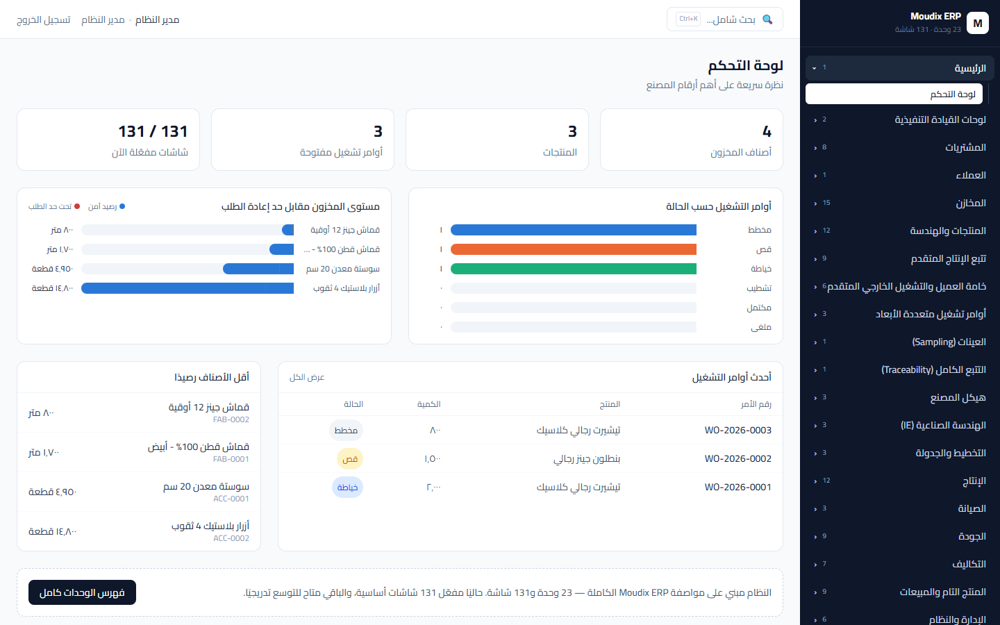
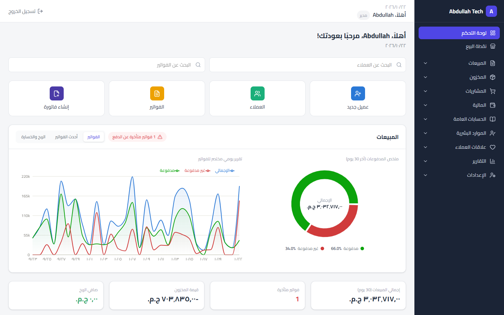
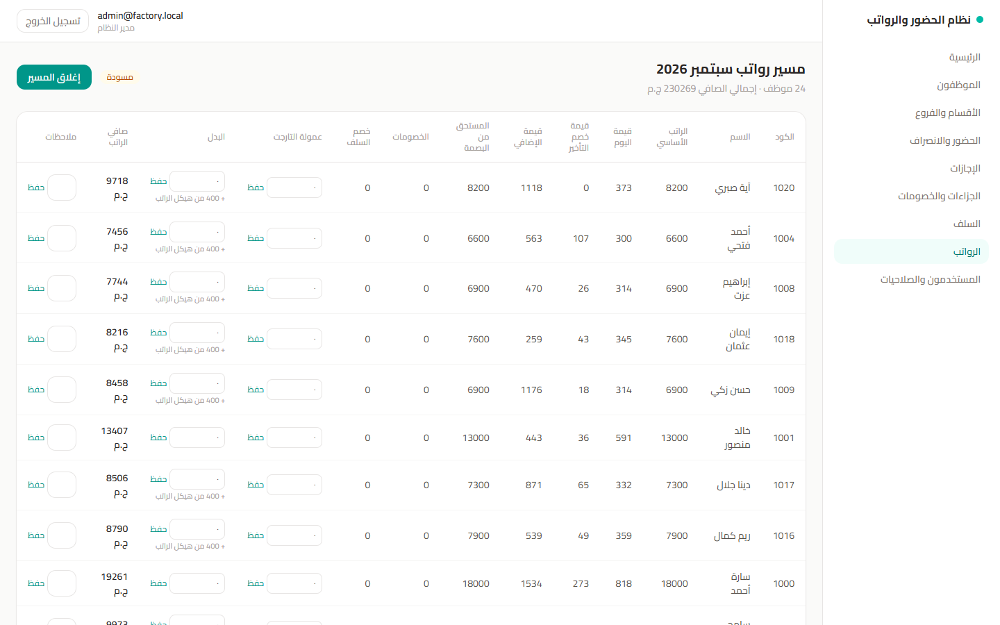
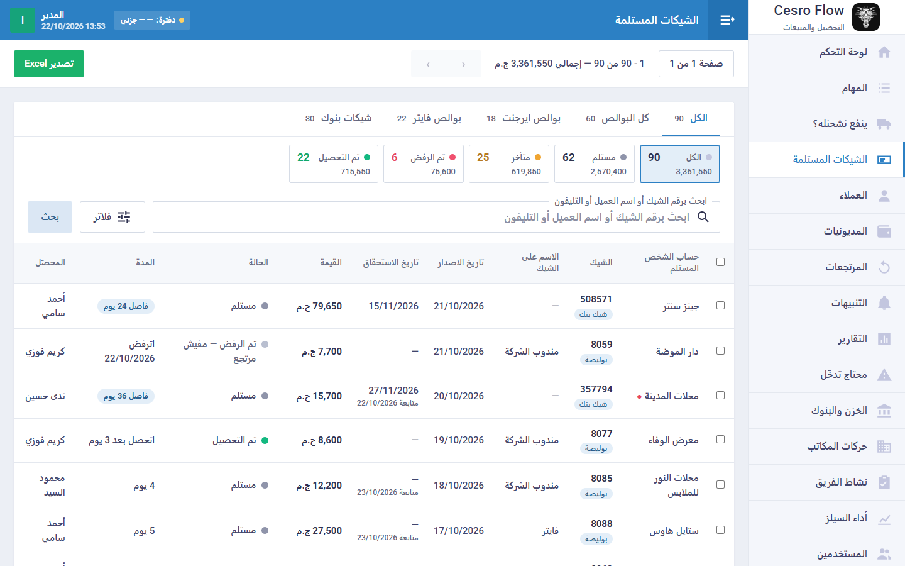

# Hi, I'm Abdullah Elsaiedy 👋

**ERP & Accounting Systems Developer**

بعمل أنظمة ERP ومحاسبة وأتمتة للمصانع والشركات

- 🏭 Accounting Systems Specialist @ **CESRO DENIM** (2020–present)
- 💼 Freelance ERP & Accounting Systems Developer (2025–present)
- 🎓 B.Sc. Software Engineering, Zagazig University (2024)
- 🤖 AI-assisted development: full business systems, delivered fast

## Selected work

| Project | What it does | Scale |
|---|---|---|
| **Moudix ERP** | ERP for a garment factory, from production to accounting | 131 screens · 23 modules |
| **Laxent ERP** | Daftra-style accounting and business management | 140+ screens · 31 reports |
| **Factory HR & Payroll** | Attendance, leaves, advances, penalties and payroll for factory workers | 8 modules |
| **Cesro Flow** | Collections & sales: cheques, bills and customer debts, synced with Daftra | Live, used daily |

> Client code is private. A live demo is available on request.

## Screenshots

<table>
  <tr>
    <td width="50%"><b>Moudix ERP</b>: factory dashboard </td>
    <td width="50%"><b>Laxent ERP</b>: sales & payments dashboard </td>
  </tr>
  <tr>
    <td width="50%"><b>Factory HR & Payroll</b>: monthly payroll run </td>
    <td width="50%"><b>Cesro Flow</b>: cheques & bills follow-up </td>
  </tr>
</table>

All screenshots use demo data; no real client data is shown.

## Built with

TypeScript · Next.js · Node.js · PostgreSQL · Prisma · Tailwind CSS

## Contact

[LinkedIn](https://www.linkedin.com/in/abdullah-elsaiedy) · [Facebook](https://www.facebook.com/abdullah.elsaiedy)
